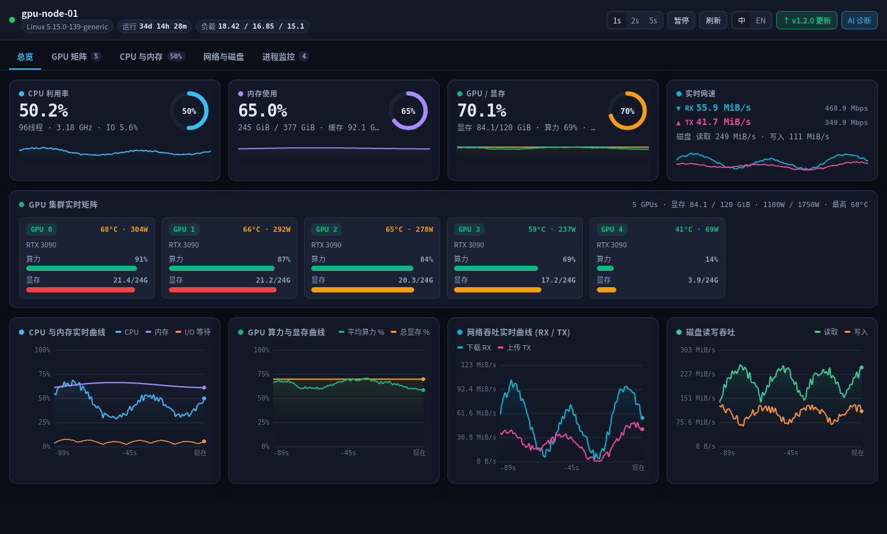
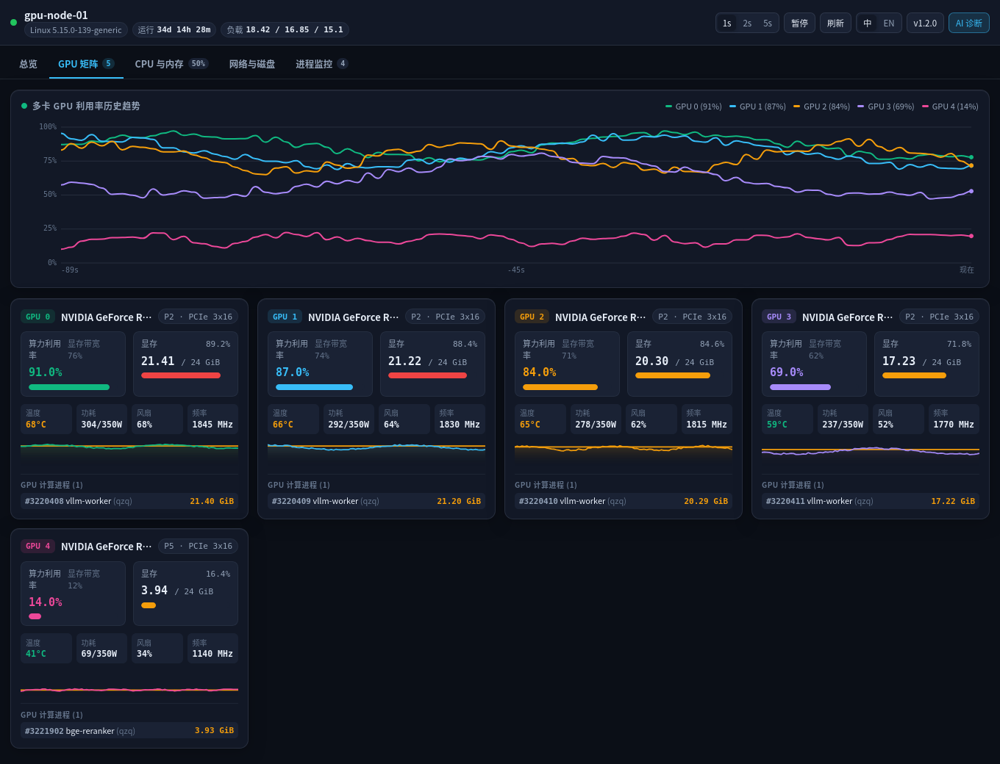
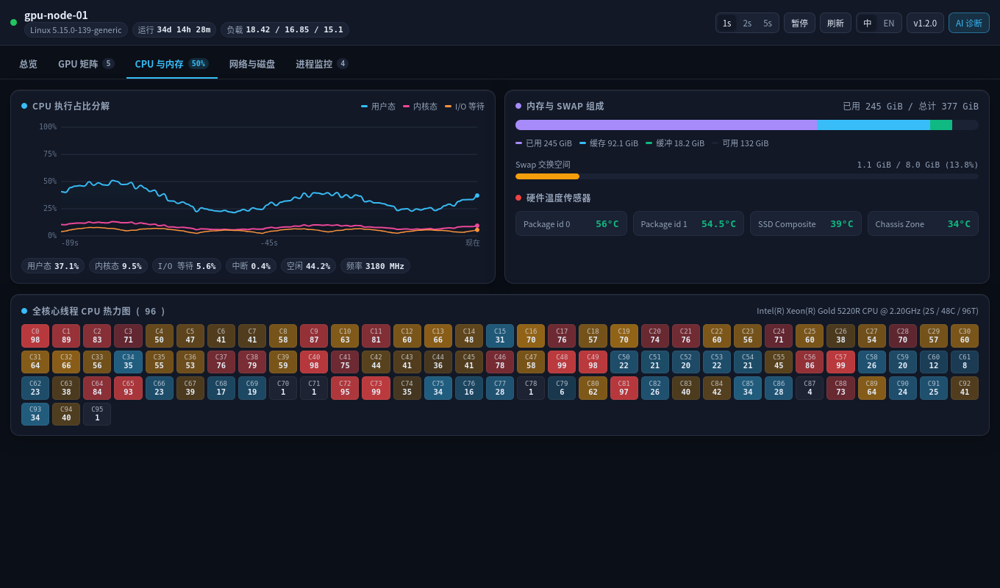
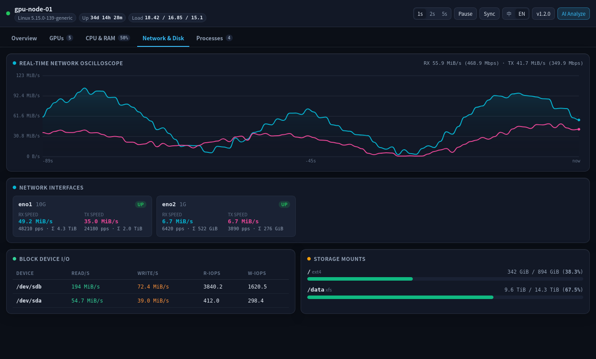
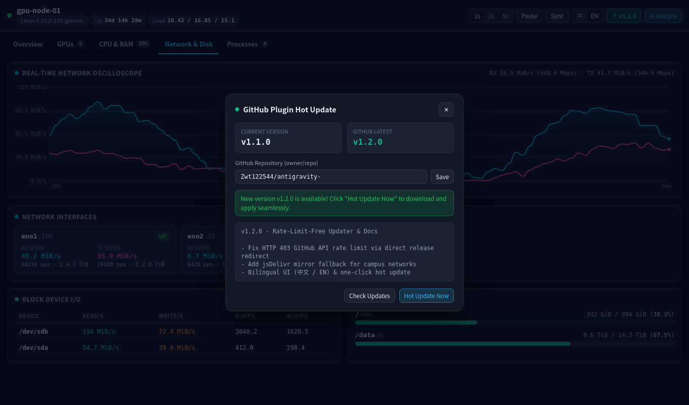

<div align="center">
  
  <h1>Linux Server Monitor for Antigravity</h1>
  <p>
    <strong>把高颜值、零依赖的 Linux 服务器实时可视化监控面板直接装进 Antigravity 边栏</strong><br/>
    Real-time Linux CPU, Memory, Multi-GPU VRAM &amp; Utilization, Network Speed, Disk I/O &amp; Process Visualizer inside Antigravity Sidebar &amp; Side Pane.
  </p>
  <p>
    
    
    
    
    
  </p>
</div>

<p align="center">
  
</p>

---

## 🎯 解决了什么痛点？（Why This Plugin?）

在远程 Linux / GPU 服务器上开发、微调大模型或部署推理服务时，几乎每个人都会遇到这些高频痛点：

| 常见痛点 (Pain Point) | 传统做法的局限 | Linux Server Monitor 的解法 |
| :--- | :--- | :--- |
| **频繁切换终端看监控，打断心流** | 一边和 AI 写代码、一边开好几个 SSH 窗口轮流敲 `nvidia-smi`、`htop`、`iftop`、`iostat` | 直接嵌入 **Antigravity 左侧边栏（全屏）** 与 **右侧辅助边栏（边聊边看）**，无需离开当前工作区 |
| **命令行只能看瞬时数字，看不到趋势** | `watch -n 1 nvidia-smi` 刷屏刺眼，无法回看 1 分钟前的算力掉帧、显存尖峰或网络抖动 | 内置 **1 Hz 后台采样 + 120 秒环形历史缓存**，打开即见平滑实时波形，支持**鼠标悬停十字准星精确读数** |
| **多卡 GPU 难以定位异常与占用者** | 多张 GPU 时难以一眼对比温度/功耗/显存均衡度，且 `nvidia-smi` 经常把进程名截断或显示 `[Not Found]` | 专属 **多卡 GPU 实时矩阵**，自动反查 `/proc/<pid>` 补全真实进程名、用户、完整命令行与每卡显存占用 |
| **传统 Web 监控部署太重、要开端口** | 部署 Grafana / Prometheus / Netdata 需要配服务、装依赖、开防火墙端口或做 SSH 端口转发 | **零第三方 Python 依赖**，直接用系统自带 `python3` 通过 Antigravity 原生 MCP 协议通信，**无需开放任何网络端口** |
| **发现异常后仍要手动复制粘贴给 AI** | 发现显存暴涨或 CPU 满载，还要手动复制终端输出贴到对话框让 AI 分析 | 内置 **「AI 诊断 / AI Analyze」按钮**，一键将当前全机核心遥测快照发送给当前对话，直接定位瓶颈 |
| **插件手动更新麻烦、校园网易触发限流** | 每次更新要手动 `git pull` / 重启服务，普通 GitHub API 在共享出口 IP 下极易报 `403 rate limit exceeded` | 内置 **免 API 限流的 GitHub 自动检测 + 一键热更新**（支持 jsDelivr 镜像回退），自动下载校验并无缝热重启 |

---

## ✨ 核心功能与实机截图（Features & Screenshots）

### 1. 全景总览仪表盘（Overview）
- **四大动态圆环仪表盘 + 迷你趋势图**：CPU 利用率（含主频与 I/O Wait）、内存占用（含 Page Cache）、GPU 集群显存与算力、实时网速（RX 下载 / TX 上传，同时显示 `MiB/s` 与 `Mbps`）。
- **GPU 集群状态条**：一眼总览所有显卡的温度、功耗、算力条与显存条，点击任意显卡直达详情页。
- **4 路高 DPI Canvas 实时曲线**：CPU & 内存、GPU 算力 & 显存、网络吞吐 RX/TX、磁盘读写吞吐，支持悬停查看任意历史秒级的精确数值。

### 2. 多卡 GPU 矩阵与进程反查（GPUs）
- **多卡利用率同屏对比曲线**：每张 GPU 独立配色，训练掉队或张量并行不均一眼可见。
- **单卡深度监控卡片**：展示算力利用率、显存带宽、VRAM（GiB & %）、温度（冷/暖/高温色阶）、功耗/上限（W）、风扇转速、核心频率、PCIe 通道速率、P-State、单卡迷你历史走势，以及运行在该卡上的全部计算进程（PID、用户、命令行、显存）。

<p align="center">
  
</p>

### 3. 全核心 CPU 线程热力图 & 内存组成（CPU & RAM）
- **CPU 执行分解曲线**：拆解用户态（User）、内核态（System）、I/O 等待（IOWait）、中断（IRQ）与平均主频。
- **全核心线程热力矩阵**：轻松承载 **96+ 逻辑核心**（如双路 Xeon 服务器），按负载自动渲染冷暖色阶，快速识别单核打满或 NUMA 负载不均。
- **内存与 Swap 组成堆叠条**：清晰区分实际已用（Used）、页面缓存（Cached）、缓冲（Buffers）、可用内存与 Swap 占用，并汇总 `hwmon` / `thermal_zone` 硬件温度传感器。

<p align="center">
  
</p>

### 4. 实时网速示波器、磁盘 I/O 与活跃进程（Network, Disk & Processes）
- **实时网速示波器**：自动量程缩放（`B/s → KiB/s → MiB/s → GiB/s`），同步显示 `Mbps / Gbps`。
- **物理网卡与磁盘明细**：自动过滤虚拟网卡，展示每张物理网卡的速率规格（如 `10G` / `1G`）、链路状态、PPS 与累计收发流量；展示物理块设备实时读写吞吐、IOPS 以及各存储挂载点容量进度条。
- **实时进程表**：支持按关键字搜索，并按 **CPU % / 内存 % / GPU 显存** 一键排序。

<p align="center">
  
</p>

### 5. 中英双语切换 & GitHub 免限流一键热更新（Bilingual UI & Hot Update）
- **一键中 / 英切换**：顶栏 **`中 | EN`** 即时生效，偏好持久化保存在 Antigravity 的 `${PLUGIN_DATA}` 目录，跨更新保留。
- **自动识别最新版本 & 一键热更新**：
  - 后台静默检查 GitHub 最新 Release（采用直连重定向 + `raw.githubusercontent.com` + `jsDelivr` 多重回退，**彻底告别 `HTTP 403 rate limit exceeded`**）。
  - 发现新版后顶栏按钮自动高亮为 **`↑ vX.Y.Z 更新`**，点击后可查看 Release Notes 并一键下载、校验清单完整性、原子替换文件并自动热重启后端服务。

<p align="center">
  
</p>

---

## 🚀 快速安装（Installation）

### 方式 1：使用 Antigravity CLI 一键安装（推荐）
```bash
agy plugin install https://github.com/Zwt122544/antigravity-
```

### 方式 2：直接克隆到 Antigravity 插件目录
```bash
git clone https://github.com/Zwt122544/antigravity-.git ~/.gemini/config/plugins/linux-monitor
```

> **无需安装任何 pip 包，也无需重启 Antigravity**（系统仅需自带 Python 3.8+；如需 GPU 监控则依赖 `nvidia-smi`）。

---

## 🧭 使用方法（Usage）

安装完成后，你可以通过以下任意入口打开实时仪表盘：

1. **左侧边栏（全屏视图）**：点击 Antigravity 左侧边栏插件入口中的 **Server Monitor**，适合大屏沉浸式查看 96 核热力图与多卡 GPU 矩阵。
2. **右侧辅助边栏（边聊边看）**：点击右侧边栏的 **`+`** 菜单选择 **Server Monitor**，响应式布局自动适配窄边栏，可一边让 Agent 跑任务一边盯紧资源曲线。
3. **对话指令唤起**：直接在聊天框输入 *"帮我打开服务器监控面板"* 或 *"看看现在几张 GPU 显存占用了多少"*，内置 Skill 会自动调用插件工具打开界面或输出摘要。

**顶栏交互控制**：
- `1s / 2s / 5s`：自由切换前端刷新频率
- `暂停 / 刷新`：随时冻结当前波形仔细排查
- `中 / EN`：无缝切换中文 / 英文界面
- `v1.2.0 / ↑ 更新`：查看版本、检查 GitHub 更新并执行一键热更新
- `AI 诊断`（侧边栏模式）：将当前全机核心资源数据直接发入对话进行 AI 诊断

---

## 🏗️ 架构与技术亮点（Architecture）

- **纯标准库 Python 3 MCP Server**（`bin/server.py`）：仅依赖 Linux `/proc`、`/sys`、`os.statvfs` 与 `nvidia-smi`，零第三方依赖，不污染任何 Conda / Pixi / venv 环境。
- **1 Hz 独立采集线程 + 环形缓存**：所有指标在后台异步采样，`open_server_monitor` / `get_server_metrics` RPC 响应耗时 **< 2 ms**，不阻塞主通信通道。
- **完全自包含的单文件 MCP App 前端**（`ui/app.html`）：内联官方 `@modelcontextprotocol/ext-apps` SDK，严格符合 Antigravity 默认 CSP 安全策略（`default-src 'none'`），自动同步 Antigravity 深色 / 浅色主题变量。

---

## 📦 发版与自动热更新流程（For Maintainers）

当发布新版本时：
1. 更新 `plugin.json` 中的 `"version"`（例如 `"1.3.0"`）。
2. 提交并推送至 `main` 分支：
   ```bash
   git add -A
   git commit -m "Release v1.3.0"
   git push origin main
   ```
3. 在 GitHub 上创建对应 Tag 的 Release（如 `v1.3.0`）。所有已安装该插件的 Antigravity 实例将在下次检测时自动亮起 **`↑ v1.3.0 更新`** 按钮，点击即可热更新。

---

## 📄 License

[MIT License](LICENSE)
